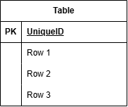

## 採点者の方へ

```
提出期限までに開発が完了しませんでした。
要件整理と設計を何とか終わらせて、環境構築の途中までです。
採点後、引き続き開発を続けて完成させたいと考えています。
お手数お掛けして申し訳ございませんが、よろしくお願いいたします。
```

## プロジェクト名

```

「模擬案件\_書籍レビューアプリ BookShelf」

```

## 概要

```

本システムは、書籍レビューアプリケーション「BookShelf」です。
ユーザーは書籍を登録・閲覧し、レビューの投稿やお気に入り登録ができます。
ジャンルによる分類やレビューへのいいね機能、平均評価に基づくランキング機能も備えています。
外部アプリケーション向けの公開API（JSON）も提供します。

```

## 使用技術

```

PHP: 8.5
Laravel: 10.x
DB: MySQL 8.4
フロントエンド: Vite, Tailwind CSS ^3.4.0, @tailwindcss/forms
開発ツール: Docker, Laravel Sail, phpMyAdmin

```

## ER図



## 環境開発URL

http://localhost

## 動作環境

```

Docker
Docker Compose
※ Windowsの場合はWSL2の利用を推奨します。

```

## 環境構築手順

1.  リポジトリをクローン

```

git clone git@github.com:Takeru-Hirayama/Preparedblade-mockcase-BookShelf.git

```

2.  .env ファイルの準備

```

cp .env.example .env

```

```

.env ファイルを開き、データベース接続情報が以下と一致していることを確認します。

DB_CONNECTION=mysql
DB_HOST=mysql
DB_PORT=3306
DB_DATABASE=laravel
DB_USERNAME=sail
DB_PASSWORD=password

重要: DB_HOST は localhost や 127.0.0.1 ではなく、Dockerコンテナ名である mysql を指定します。

```

3.  パッケージのインストール

```

docker run --rm -u "$(id -u):$(id -g)" -v "$(pwd):/var/www/html" -w /var/www/html -e COMPOSER_CACHE_DIR=/tmp/composer_cache laravelsail/php82-composer:latest composer install

```

4. Sailの起動とエイリアス設定

```

# Sailをバックグラウンドで起動

./vendor/bin/sail up -d

# エイリアスを設定して 'sail' だけでコマンドを実行できるようにする

echo "alias sail='[ -f sail ] && bash sail || bash vendor/bin/sail'" >> ~/.zshrc

# シェルを再起動するか、新しいターミナルを開いてエイリアスを有効にする

exec $SHELL

```

5. アプリケーションキーの生成

```

ルートで以下のコマンドを実行する
sail artisan key:generate

```

6. データベースのマイグレーションと初期データ投入

```

以下のコマンドでテーブルを作成し、初期データを投入します。
sail artisan migrate --seed

※既存のデータベースをリセットしたい場合は以下を実行してください。
sail artisan migrate:fresh --seed

```

7. フロントエンドのビルド

```

sail npm install
sail npm run dev

```

## テスト実行

```

sail artisan test
カバレッジ付きで実行する場合:

sail artisan test --coverage

```

## 機能一覧

```

ユーザー認証（登録、ログイン、ログアウト）
書籍登録・一覧取得・検索・単体取得
書籍詳細表示・削除
書籍編集
レビュー登録・編集・削除
お気に入り登録・削除
ジャンル登録・編集・詳細
ランキング画面
公開API（書籍CRUD）
APIエンドポイント一覧
認証不要の公開APIです。全エンドポイントは /api/v1 プレフィックス配下に定義されています。

```

## APIエンドポイント一覧

```

HTTPメソッド URI 　　　　　　　　　　　　説明 　　　　　　認証 　　　　　　　認証（応用）
GET　　　 /api/v1/books 　　　　　書籍一覧を取得する 　　不要 　　　　不要
GET　　　 /api/v1/books/{book} 　書籍詳細を取得する 　　不要 　　　　不要
POST　　 /api/v1/books 　　　　　書籍を新規登録する 　　不要 　　　　★ Sanctum 必須
PUT　　　 /api/v1/books/{book} 　書籍を更新する 　　　　不要 　　　　★ Sanctum + BookPolicy（所有者のみ）
DELETE　 /api/v1/books/{book} 　書籍を削除する 　　　　不要 　　　　★ Sanctum + BookPolicy（所有者のみ）

```

## 作成者

````

平山健

```git

````
